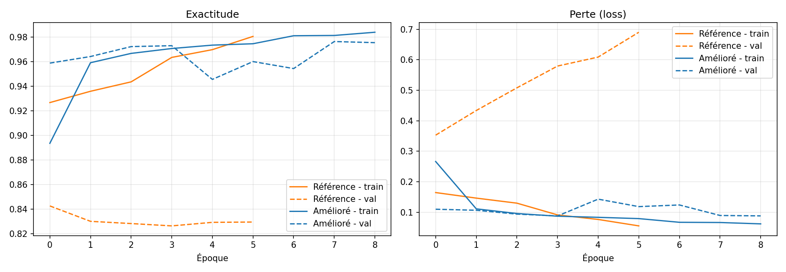
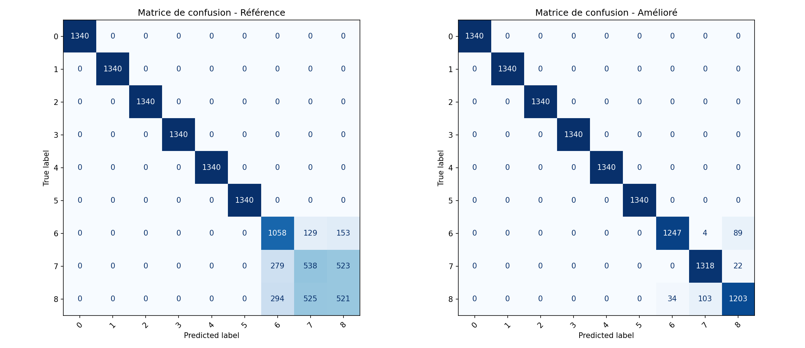

# CNN Fingerprinting — Classification d’empreintes matérielles

Ce projet réalise la classification d’empreintes matérielles à partir de spectrogrammes STFT de signaux de tension. Il compare deux architectures convolutives : un modèle de référence et un modèle amélioré entraîné sur neuf dispositifs distincts.

## Résultats

Le modèle amélioré obtient une **accuracy test de 97,91 %**, contre **84,22 %** pour le modèle de référence. Le F1 macro passe de 83,87 % à 97,90 %, tandis que la loss test est réduite de 0,3507 à 0,0765.

| Modèle | Paramètres | Époques | Temps | Accuracy train | Accuracy validation | Accuracy test | F1 macro test | Loss test |
|---|---:|---:|---:|---:|---:|---:|---:|---:|
| Référence | 1 848 937 | 6 | 7,6 min | 98,05 % | 84,27 % | 84,22 % | 83,87 % | 0,3507 |
| Amélioré | 1 209 193 | 9 | 17,2 min | 98,39 % | 97,64 % | **97,91 %** | **97,90 %** | **0,0765** |

Les valeurs détaillées sont disponibles dans [`outputs/comparaison.csv`](outputs/comparaison.csv).

## Courbes d’apprentissage



Les courbes permettent de comparer l’évolution de l’accuracy et de la loss pendant l’entraînement et la validation.

## Matrices de confusion



La matrice du modèle amélioré montre nettement moins d’erreurs de classification que celle du modèle de référence.

## Jeu de données

Le dataset contient neuf classes, représentées par les dossiers `0` à `8` dans `input/DeviceSpecific_Dataset/`(a telecharger dans kaggle).

```text
input/
└── DeviceSpecific_Dataset/
    ├── 0/
    ├── 1/
    ├── 2/
    ├── 3/
    ├── 4/
    ├── 5/
    ├── 6/
    ├── 7/
    └── 8/
```

Chaque dossier contient les spectrogrammes correspondant à un appareil ou dispositif. Les images sont redimensionnées à **128 × 128 pixels** puis normalisées entre 0 et 1 avant l’entraînement.

## Méthodologie

- Découpage des données en ensembles d’entraînement, de validation et de test
- Séparation des images afin d’éviter les chevauchements entre les ensembles
- Extraction de caractéristiques avec des blocs convolutionnels
- Batch Normalization, ReLU, max pooling et dropout
- Utilisation d’un pooling global avant les couches denses
- Early stopping et réduction adaptative du taux d’apprentissage
- Évaluation avec accuracy, F1 macro, loss et matrices de confusion

## Modèles

Les modèles entraînés sont stockés dans le dossier `outputs/` :

- `outputs/cnn_baseline.keras` : modèle de référence
- `outputs/cnn_improved.keras` : modèle amélioré
- `outputs/courbes_apprentissage.png` : courbes d’entraînement
- `outputs/matrices_confusion.png` : matrices de confusion
- `outputs/comparaison.csv` : tableau comparatif des performances

## Application Streamlit

Une interface interactive permet de charger un spectrogramme et d’obtenir la prédiction du modèle.

### Installation

Depuis le dossier du projet :

```bash
python3 -m venv .venv
source .venv/bin/activate
python -m pip install -r requirements.txt
```

### Lancer l’application

```bash
python -m streamlit run app.py
```

L’application utilise par défaut :

```text
outputs/cnn_improved.keras
```

Puis ouvre l’interface dans le navigateur. Il suffit d’importer une image PNG, JPG ou JPEG.

## Structure du projet

```text
CNN_fingerprints/
├── app.py
├── input/
│   └── DeviceSpecific_Dataset/
├── outputs/
│   ├── cnn_baseline.keras
│   ├── cnn_improved.keras
│   ├── comparaison.csv
│   ├── courbes_apprentissage.png
│   └── matrices_confusion.png
├── cnn-for-fingerprinting_v2.ipynb
├── requirements.txt
└── README.md
```

## Technologies utilisées

- Python
- TensorFlow / Keras
- NumPy
- Pandas
- Scikit-learn
- Matplotlib
- Pillow
- Streamlit
- Jupyter Notebook
